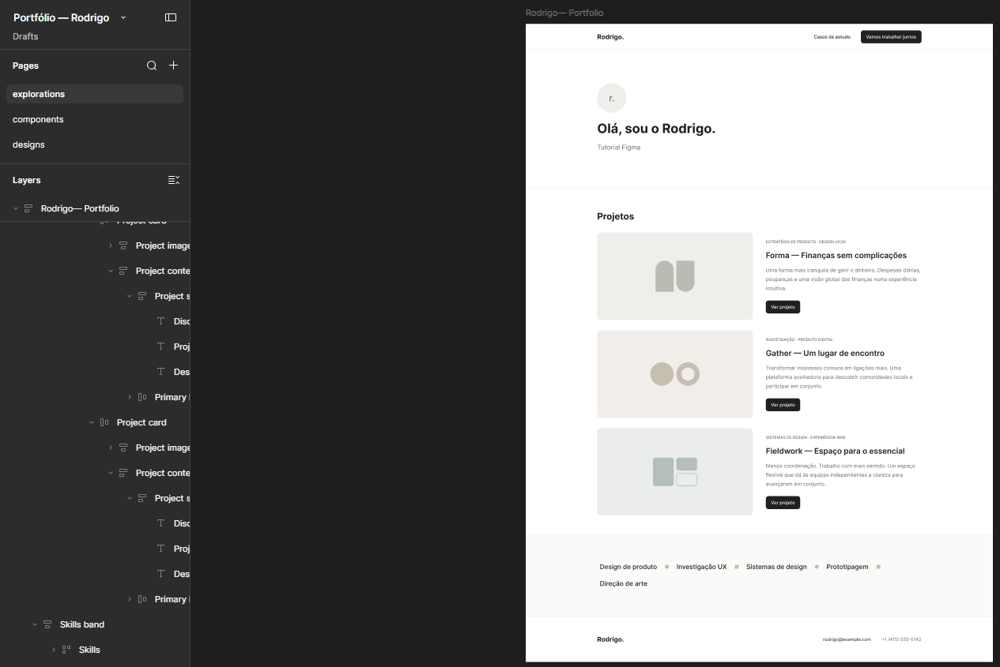
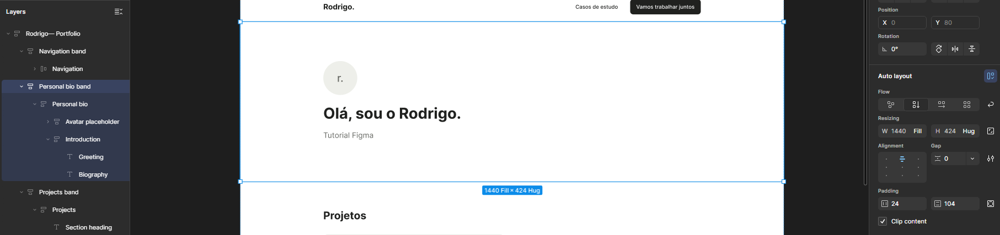
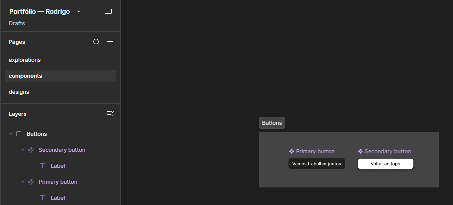
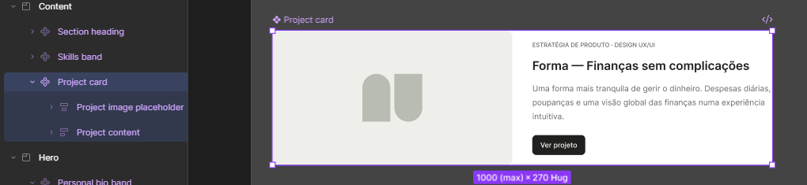
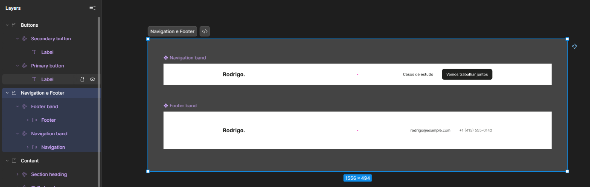
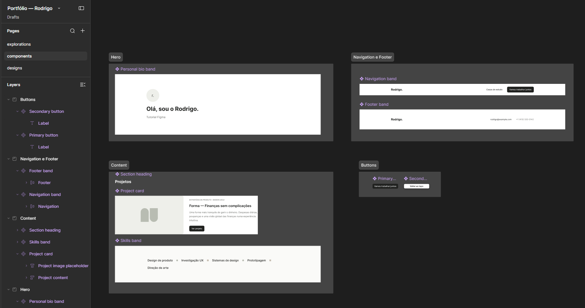
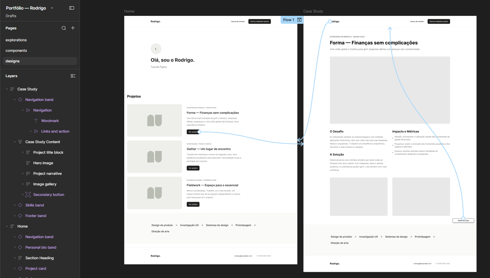
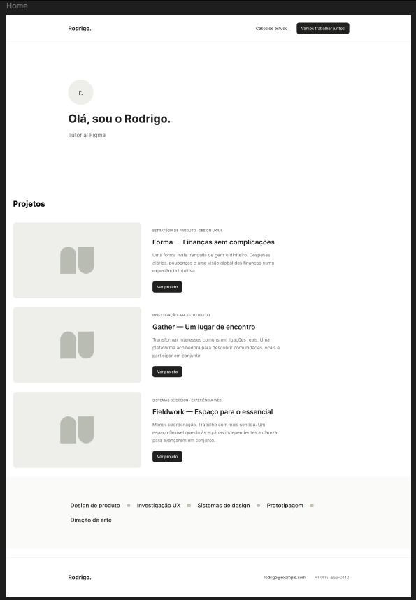
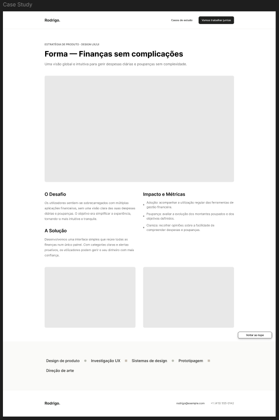

# Portfolio Pessoal — UI/UX Design System e Prototipagem no Figma

Projeto pratico desenvolvido no Figma com foco na construcao de um sistema de design escalavel, aplicacao de regras de Auto Layout, componentizacao com variantes e prototipagem interativa para web desktop (1440px).

---

## Estrutura do Ficheiro Figma

O projeto segue a metodologia de organizacao em 3 paginas:

* **explorations**: Rascunho inicial e estruturacao de wireframe previa a criacao de componentes.
* **components**: Biblioteca central do sistema de design, organizada em seccoes:
  * **Buttons**: Botoes com hierarquia primaria e secundaria, incluindo efeitos de elevacao (Drop shadow).
  * **Hero**: Bloco biografico com alinhamento vertical e responsividade (Personal bio band).
  * **Content**: Titulos estruturais (Section heading), cartoes de projeto responsivos (Project card) e faixas de competencias (Skills band).
  * **Navigation e Footer**: Cabecalho e rodape globais com Auto Layout.
* **designs**: Telas finais funcionais para Desktop:
  * **Home**: Grelha de 1440px com contentor centrado a 1000px, cartoes com espacamento homogeneo e substituicao de texto em instancias.
  * **Case Study**: Narrativa aprofundada de projeto, grelha de metricas e galeria visual.

---

## Evolucao do Projeto (Tutoriais 01 a 07)

| Passo | Foco Tecnico | Pre-visualizacao |
| :--- | :--- | :--- |
| **01** | Wireframe e Estrutura Base |  |
| **02** | Auto Layout e Aninhamento da Biografia |  |
| **03** | Sistema de Botoes e Estilos de Elevacao |  |
| **04** | Componente Responsivo Project Card |  |
| **05** | Barras de Navegacao e Rodape |  |
| **06** | Organizacao da Biblioteca de Componentes |  |
| **07** | Prototipagem, Interacoes e Fluxo |  |

---

## Paginas Finais

### Pagina Principal (Home)

### Estudo de Caso (Case Study)

---

## Comportamentos do Prototipo

* **Navegacao Bidirecional**: O botao "Ver projeto" conduz a pagina de detalhe (Navigate to), enquanto o logotipo na navegacao superior permite regressar a pagina inicial.
* **Scroll to com Animacao**: O botao secundario de apoio na pagina de estudo de caso executa uma transicao suave ate ao topo da pagina (Scroll to com curva Ease out, 400ms).
* **Consistencia Visual**: Sistema tipografico baseado na familia Inter, escala neutra e alinhamento centrado a 1000px em ecra de 1440px.

---

## Ficheiro Fonte

O ficheiro original do Figma (portfolio-rodrigo.fig) encontra-se disponivel na pasta deste projeto para consulta direta de propriedades, camadas e variaveis.
